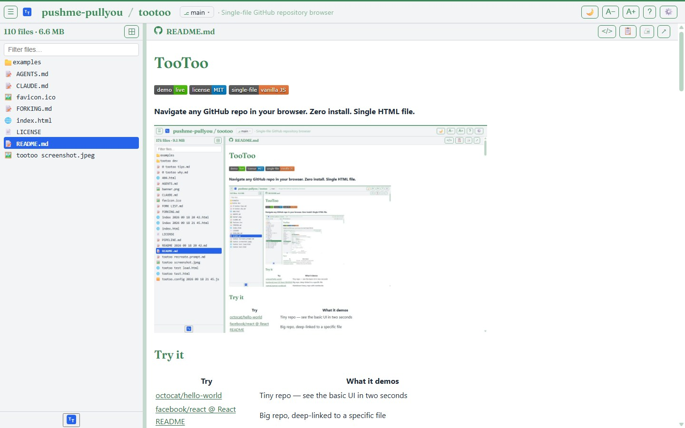

# TooToo

[](https://pushme-pullyou.github.io/tootoo/)
[](LICENSE)
[](index.html)

**Navigate any GitHub repo in your browser. Zero install. Single HTML file.**



## Try it

| Try | What it demos |
| --- | --- |
| [octocat/hello-world](https://pushme-pullyou.github.io/tootoo/?owner=octocat&repo=hello-world) | Tiny repo — see the basic UI in two seconds |
| [facebook/react @ React README](https://pushme-pullyou.github.io/tootoo/?owner=facebook&repo=react#packages/react/README.md) | Big repo, deep-linked to a specific file |
| [openai/openai-cookbook](https://pushme-pullyou.github.io/tootoo/?owner=openai&repo=openai-cookbook) | Markdown-heavy repo with notebooks |
| [torvalds/linux @ master](https://pushme-pullyou.github.io/tootoo/?owner=torvalds&repo=linux&branch=master) | Too large — over GitHub's 100,000-file / 7 MB tree limit, so it shows the "too large" notice |
| [kubernetes/kubernetes @ master](https://pushme-pullyou.github.io/tootoo/?owner=kubernetes&repo=kubernetes&branch=master) | 30,000+ files — the full tree loads and filters |

## [Examples](examples/)

The [`examples/`](examples/) folder has sample content for every renderer. A few worth a click:

* [`docs/formatting-showcase.md`](examples/docs/formatting-showcase.md) — Markdown headings, lists, code, and links
* [`svg/diagram.svg`](examples/svg/diagram.svg) — inline SVG with a raw-source toggle
* [`images/the-scream.jpg`](examples/images/the-scream.jpg) — image viewer
* [`data/us-county-state-latlon-pop.csv`](examples/data/us-county-state-latlon-pop.csv) — CSV table
* [`pdf/sample.pdf`](examples/pdf/sample.pdf) — PDF viewer
* [`html/sample-page.html`](examples/html/sample-page.html) — sandboxed HTML preview
* [`code/code-sample.js`](examples/code/code-sample.js) — syntax-highlighted code
* [`audio/sample.wav`](examples/audio/sample.wav) — audio player
* [`video/pano.mp4`](examples/video/pano.mp4) — video player

## Why TooToo?

* **Instant cross-tree filter.** Type a few letters, see every matching path. GitHub's web UI only filters the current folder.
* **Sticky sidebar, sticky breadcrumbs.** Scroll a long file without losing context.
* **Built for phones too.** A−/A+ buttons resize everything; the sidebar collapses to a sensible width on narrow screens; dark mode is one tap.
* **Works next to a local checkout.** Drop `index.html` next to a cloned repo and TooToo reads it from disk via `file://` — no API quota burn, no internet required.
* **Drag-and-drop friendly.** One file. Copy it into any repo, push, enable Pages, done.

## Features

* **Single file** — one `index.html` with HTML, CSS, and JS inline
* **Auto-detect** — reads `.git/config`, parses GitHub Pages URLs, or caches to localStorage
* **File tree** — sidebar with collapsible folders, filter input, keyboard navigation
* **Content viewer** — Markdown (rendered via marked), syntax-highlighted code, images, audio, video, PDF, spreadsheets (SheetJS)
* **Dark mode** — toggle with persisted preference
* **Resizable sidebar** — drag to resize, width saved across visits
* **Collapsible sidebar** — toggle with the header button or Ctrl/⌘ B, state persisted
* **Font size controls** — A−/A+ buttons, helpful on phones
* **GitHub token support** — optional PAT for private repos and higher rate limits (5,000/hr vs 60/hr)
* **File text cache** — LRU in-memory + sessionStorage cache to reduce API calls without persisting file contents after the tab session
* **Hash routing** — deep-link to any file or heading via `#path/to/file#anchor`
* **Copy / New Tab / Download** — copy raw text, open viewable files in a new tab, or save non-viewable files (3D, fonts, archives, spreadsheets, binaries) straight to disk
* **Rendered ↔ Raw toggle** — for Markdown, HTML, and SVG files; preference saved per file type
* **Safer HTML previews** — rendered HTML uses a strict iframe sandbox so repository scripts do not run by default
* **Self-test** — render every file off-screen and report which fail to display (About → 🧪 Run self-test)

## Quick Start

**On GitHub Pages** — visit the [live URL](https://pushme-pullyou.github.io/tootoo/) above.

**Drop-in mode** — copy `index.html` into any GitHub repo folder. Open it in a browser. It walks up the directory tree looking for `.git/config` to find the owner and repo.

**Pre-configured** — ship a `tootoo.config.js` beside `index.html` (see this repo's own for the shape), or edit the `CONFIG` object at the top of the script:

```js
const CONFIG = {
  owner: 'pushme-pullyou',
  repo: 'tootoo',
  branch: 'main',
  storagePrefix: 'tootoo',
  appName: 'TooToo',
  sourceRepoUrl: 'https://github.com/pushme-pullyou/tootoo',
};
```

These are the common knobs; `CONFIG` also supports theming and filtering options (`themeColor`, `subtitle`, `hiddenFolders`/`hiddenFiles`, `headingFont`) — see [`FORKING.md`](FORKING.md) for the full set. To brand a fork, ship a `favicon.ico` beside `index.html`.

## Fork & Customize

Want your own TooToo pointing at your own repo? It takes about a minute.

1. **Fork** this repository on GitHub (top-right of the repo page).
2. **Edit `CONFIG`** at the top of the `<script>` block in [`index.html`](index.html):

   ```js
   const CONFIG = {
     owner: '',                  // optional: pre-load a specific repo
     repo: '',
     branch: '',                 // empty = use the default branch
     storagePrefix: 'mybrowser', // localStorage namespace
     appName: 'MyBrowser',       // <title> + About heading
     sourceRepoUrl: 'https://github.com/you/your-fork', // "Source" link in the About (?) panel
   };
   ```

   On GitHub Pages, the repo to browse auto-detects from the hostname (`<you>.github.io/<fork>/`), so `owner`/`repo` can stay empty for the Pages deploy. The brand icon at the top left always returns to the start — this page, with no `?owner=…` or `#file`.

3. **Customize the favicon** (optional) — drop a `favicon.ico` beside `index.html` in your fork.

4. **Enable Pages**: in your fork's *Settings → Pages*, deploy from the `main` branch root. Your fork goes live at `https://<you>.github.io/<your-fork>/`.

For deeper customization (adding renderers, new buttons, etc.), see [`FORKING.md`](FORKING.md) — covers the architecture, render pipelines, and the gotchas (file://, rate limits, blob lifecycle).

### Browser storage keys

TooToo stores preferences and the GitHub token in the browser's `localStorage`. Recently viewed file contents are cached in `sessionStorage`, so they expire when the tab session ends. Keys are scoped per `location.pathname`, so two TooToo instances on the same origin keep separate state.

| Key | Purpose |
| --- | --- |
| `tootoo:<pathname>:repo` | Detected owner / repo / default branch |
| `tootoo:<pathname>:darkMode` | Dark mode on/off |
| `tootoo:<pathname>:fontSize` | Font size override (px) |
| `tootoo:<pathname>:sidebarWidth` | Last sidebar width (px) |
| `tootoo:<pathname>:sidebarHidden` | Sidebar collapsed on/off (Ctrl/⌘ B) |
| `tootoo:<pathname>:fileTextCache` | Session-only LRU cache of recently viewed file contents |
| `tootoo:<pathname>:viewPref:<ext>` | Rendered / Raw toggle per file extension |
| `tootoo:<pathname>:currentFile:<owner>/<repo>/<branch>` | Last-opened file in that repo (sessionStorage — clears with the tab) |
| `tootoo:<pathname>:githubToken` | GitHub Personal Access Token for this TooToo instance |

To wipe state, click ⚙️ Token → **Reset all TooToo data**, or clear both `localStorage` and `sessionStorage` in DevTools.

## Constraints

* Vanilla JavaScript — no frameworks, no build tools, no Node.js
* ES2020+ — `const`/`let`, arrow functions, template literals, async/await
* Static hosting only — GitHub Pages or open from `file://`
* External CDN deps: marked, highlight.js, DOMPurify, SheetJS

## Where development happens

This repo carries the **finished app**, nothing else. `index.html` is a **generated build** — never hand-edited. The component sources, assembler, tests, agenda, and release pipeline live in the [Dolittle workshop](https://github.com/pushme-pullyou/dolittle), which pushes fresh builds here (and to every other TooToo install). The roadmap lives in the workshop's agenda.

Earlier history — the 2026-04 → 2026-10 development record, prompts, and snapshots — is preserved intact in the [tootoo-2026-10](https://github.com/pushme-pullyou/tootoo-2026-10) archive repo.

## Project Structure

```text
index.html                    ← the app (GENERATED by the workshop — do not hand-edit)
tootoo.config.js              ← this repo's own per-install config
favicon.ico                   ← the TT mark
README.md                     ← user-facing docs (this file)
FORKING.md                    ← architecture + recipes for forkers
examples/                     ← sample content for every renderer (with index README)
```

## License

MIT — Copyright pushme-pullyou. See [`LICENSE`](LICENSE).

## Change Log

* 2026-11-01 — Header: the brand icon now always goes back to the start (this page, no `?owner=…` or `#file`); on narrow screens the right-hand buttons slide over the subtitle and move to a second row only when they'd cover owner / repo. `headingFontUrl` now also accepts a `.ttf` / `.woff2` font file, not just a Google Fonts stylesheet. Fixed a token save that could fail silently.
* 2026-10-31 — Fresh start: this repo is now just the finished app — `index.html`, its config, and the `examples/` content. Development (component sources, assembler, pipeline, tests) moved to the [Dolittle workshop](https://github.com/pushme-pullyou/dolittle); the previous repo, with the full 2026-04 → 2026-10 changelog and archives, lives on as [tootoo-2026-10](https://github.com/pushme-pullyou/tootoo-2026-10)
